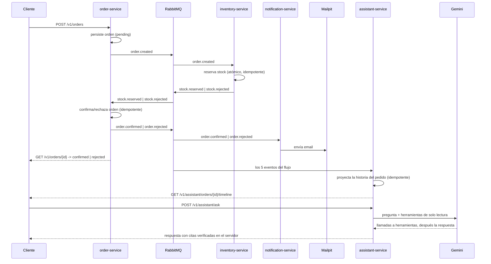

# Event-Driven Orders

> Sistema de procesamiento de órdenes basado en eventos — microservicios asíncronos en **Python 3.12 / FastAPI**, más uno en **TypeScript / NestJS**, comunicados por **RabbitMQ**, con **Clean Architecture + DDD**.
> Portfolio project: idempotencia, atomicidad anti race-condition, DLQ + retries con backoff, observabilidad (logging JSON + correlation IDs), un asistente con IA que cita los pedidos y eventos en que se basa, y tests e2e contra infraestructura real.

[](.github/workflows/ci.yml)
[](https://www.python.org/)
[](https://fastapi.tiangolo.com/)
[](#testing)
[](#testing)
[](#testing)
[](#testing)

---

## Qué es

Sistema de e-commerce dividido en **4 microservicios** que se comunican exclusivamente por **eventos** a través de un message broker (RabbitMQ), demostrando comunicación asíncrona, idempotencia, dead-letter queues, retries con backoff y eventual consistency. Tres están escritos en Python; el cuarto, en TypeScript, consume los mismos eventos sin importar código de Python: el contrato es el JSON que viaja por el broker.

```
   [Cliente]
       │ POST /v1/orders
       ▼
┌──────────────┐   order.created     ┌──────────────────┐
│ order-service│ ───────────────────▶│ inventory-service│
│  (FastAPI)   │◀─────────────────── │  reserva stock    │
└──────┬───────┘  stock.reserved /   └──────────────────┘
       │          stock.rejected
       │ order.confirmed / order.rejected
       ▼
┌─────────────────────┐
│ notification-service │  envía email (Mailpit)
└─────────────────────┘

 los 5 eventos ──▶ ┌───────────────────┐
                   │ assistant-service │  read model con la historia de cada pedido
                   │     (NestJS)      │  GET  /v1/assistant/orders/{id}/timeline
                   └─────────┬─────────┘  POST /v1/assistant/ask (agente LLM, Gemini)
                             │
                          [Redis]  rate limit + caché del timeline
```



## Servicios

| Servicio | Tipo | Responsabilidad |
|---|---|---|
| `order-service` | FastAPI (REST + consumer) | Crea órdenes, orquesta el ciclo de vida, expone `/v1/orders` |
| `inventory-service` | Worker (consumer) | Reserva stock con transacción atómica anti race-condition |
| `notification-service` | Worker (consumer) | Envía notificaciones por email (Mailpit) |
| `assistant-service` | NestJS (REST + consumer) | Proyecta los 5 eventos en un read model propio (CQRS), expone la historia de cada pedido y responde preguntas con un agente LLM (Gemini) que solo lee ese read model. Redis para el rate limit y la caché |

## Stack

| Capa | Tecnología |
|---|---|
| Lenguaje | Python 3.12; TypeScript 6 en `assistant-service` |
| Framework HTTP | FastAPI + Uvicorn; NestJS 12 |
| Mensajería | RabbitMQ + `aio-pika`; `amqplib` |
| Persistencia | PostgreSQL 16 (database-per-service) + SQLAlchemy + Alembic; Prisma 7 |
| Validación / contratos | Pydantic v2; zod, verificado contra fixtures exportados de Pydantic |
| Caché / rate limit | Redis 8 (`redis` 6) en `assistant-service` |
| IA | Gemini en el plan gratis (`@google/genai`), con function calling; un modelo `fake` para correr sin clave |
| Email (dev) | Mailpit (SMTP + API de inspección, multi-arquitectura) |
| Observabilidad | `structlog` (logging JSON) + correlation ID por contexto; `nestjs-pino`, `prom-client` |
| Testing | pytest, pytest-asyncio, `testcontainers` (Postgres y RabbitMQ reales), httpx; Vitest + supertest |
| Lint / types | ruff + mypy; oxlint + `tsc` + Prettier |
| Infra | Docker Compose |
| CI/CD | GitHub Actions |

## Arquitectura

Cada servicio aplica **Clean Architecture + DDD** (capas `domain` / `application` / `infrastructure` / `presentation` / `di`), siguiendo el patrón del proyecto [Monolith](https://github.com/MauriDev94/Api_monolith).

- **El broker es un detalle de infraestructura.** Los use cases hablan con el puerto `EventPublisher` (`application/contracts/`); la implementación con `aio-pika` vive en `infrastructure/messaging/`.
- **`presentation/` = puntos de entrada (adapters).** En `order-service`: `presentation/http/` (routers + schemas) y `presentation/consumers/` (handlers de eventos). En los workers: solo `presentation/consumers/`.
- **`shared/contracts/`** es la única fuente de los *integration events* (Pydantic): los servicios no comparten entidades de dominio, solo estos modelos viajan por el broker. Cada servicio mapea entre su dominio y estos contratos.
- **`shared/messaging/`** y **`shared/observability/`** son infraestructura transversal (retry/DLQ y logging) reusada por los 3 servicios Python — nunca lógica de negocio.
- **`assistant-service` no importa `shared/`.** Replica los contratos con zod, y CI los compara con fixtures generados desde los modelos Pydantic (`scripts/export_contract_fixtures.py`). También porta el protocolo de retry/DLQ: mismas colas, mismo header, mismas métricas ([ADR-0021](docs/adr/0021-assistant-service-en-typescript.md)).
- **database-per-service:** `order-service`, `inventory-service` y `assistant-service` tienen cada uno su Postgres; `notification-service` no tiene DB (consumer puro).

## Patrones demostrados

| Patrón | Dónde | Qué resuelve |
|---|---|---|
| **Idempotencia** (`processed_events`) | `order-service`, `inventory-service`, `assistant-service` (`order_event_log`) | RabbitMQ es *at-least-once*: un evento redelivered no duplica efectos de negocio (`INSERT ... ON CONFLICT DO NOTHING` sobre `event_id`, misma transacción que la lógica de negocio) |
| **Atomicidad anti race-condition** | `inventory-service` | `UPDATE products SET available_quantity = available_quantity - :qty WHERE sku = :sku AND available_quantity >= :qty` + `SAVEPOINT` por orden (all-or-nothing) — Postgres serializa vía row-level locking |
| **DLQ + retries con backoff** | `shared/messaging/` (3 servicios Python) y su versión en TypeScript (`assistant-service`) | 3 etapas (5s/30s/2m) vía colas TTL + dead-letter, header `x-retry-count`, clasificación transient/permanent |
| **Eventual consistency** | flujo completo | La orden pasa por `pending -> confirmed/rejected` de forma asíncrona, sin transacción distribuida |
| **Correlation ID end-to-end** | HTTP -> eventos -> 3 consumers | `structlog.contextvars` propaga el mismo id desde el `X-Correlation-ID` del request hasta cada log de cada servicio |
| **Logging estructurado (JSON)** | `shared/observability/` | Toda línea de log (propia o de librerías) sale como JSON filtrable con `jq` |
| **Database-per-service** | `order-service`, `inventory-service`, `assistant-service` | Cada servicio es dueño exclusivo de su esquema; integración solo por eventos |
| **Read model (CQRS)** | `assistant-service` | La historia de cada pedido se arma solo con eventos. Tolera eventos fuera de orden (un `stock.reserved` que llega antes que `order.created`) y usa lock optimista entre proyecciones concurrentes |
| **Contratos independientes del lenguaje** | `shared/contracts/` → zod | Un consumidor en TypeScript procesa los mismos eventos; los fixtures de Pydantic detectan la deriva en CI |
| **Agente LLM con herramientas de solo lectura** | `assistant-service` | El loop vive en la aplicación y el modelo solo puede leer. Las citas salen de lo que devolvieron las herramientas, y una respuesta que nombra un ID inventado se reemplaza |
| **Caché invalidada por eventos** | `assistant-service` (Redis) | Cache-aside del timeline que cada evento invalida tras el commit; un contador de generación evita guardar el estado viejo en una carrera. Falla abierta |
| **Rate limit y tope diario que fallan cerrado** | `assistant-service` (Redis) | Ventana fija por IP con `INCR` + `EXPIRE NX` en un `MULTI`, y un tope global de llamadas al modelo por día del Pacífico, cuando Gemini reinicia su cuota; sin Redis no pasa ninguna pregunta |

## Estructura del monorepo

```
event-driven-orders/
├── docker-compose.yml          # RabbitMQ + 3x Postgres + Redis + Mailpit + 4 servicios + Prometheus + Grafana
├── .env.example                # variables para docker-compose
├── Makefile                    # install / up / down / logs / ps / test / lint / format / e2e
├── .github/                    # CI (ci.yml) + plantillas de PR/issues + CODEOWNERS
├── shared/
│   ├── contracts/               # integration events (Pydantic): BaseEvent + Order*/Stock*
│   ├── messaging/                # retry policy + dispatcher (DLQ/backoff), reusado por los 3 servicios Python
│   └── observability/            # logging JSON (structlog) + correlation id contextvars
├── scripts/                     # generate_env.py y export_contract_fixtures.py
├── tests/e2e/                   # tests e2e contra el stack real (make e2e)
└── services/
    ├── order-service/          # FastAPI: REST + consumer (feature: orders)
    ├── inventory-service/      # worker: consumer (feature: inventory)
    ├── notification-service/   # worker: consumer, sin DB (feature: notifications)
    └── assistant-service/      # NestJS: consumer + REST (features: order-history, assistant), fuera del workspace de uv
```

Cada servicio Python: `app/{core,common,features/<feature>/{domain,application,infrastructure,presentation,di}}`. `assistant-service` usa las mismas capas en `src/features/<feature>/`, y el cableado de DI vive en el módulo de Nest de cada feature.

## Puesta en marcha

```bash
make env       # crea .env con contraseñas aleatorias; si ya existe, solo le agrega las claves nuevas
make up        # docker compose up -d --build
make ps        # ver healthchecks
make logs      # seguir logs
make down      # detener
```

`make env` copia `.env.example` a `.env` y llena cada contraseña vacía (RabbitMQ, las tres bases, Redis y Grafana) con un valor aleatorio. `.env` no se versiona, y `docker compose` no arranca si falta alguna contraseña. Si `.env` ya existe, `make env` conserva sus valores y solo agrega las claves que le falten, por ejemplo las de un servicio nuevo. Si lo regeneras entero con `--force`, corre `docker compose down -v`: Postgres, Grafana y RabbitMQ guardan la contraseña con la que se creó su volumen.

| Servicio / infra | URL local |
|---|---|
| order-service `/health` | http://localhost:8001/health |
| inventory-service `/health` | http://localhost:8002/health |
| notification-service `/health` | http://localhost:8003/health |
| assistant-service `/health` | http://localhost:8004/health |
| RabbitMQ Management | http://localhost:15672 (usuario `guest`, contraseña `RABBITMQ_DEFAULT_PASS` de tu `.env`) |
| Mailpit UI | http://localhost:8025 |
| Postgres orders / inventory / assistant | localhost:5433 / localhost:5434 / localhost:5435 |
| Redis (`assistant-service`) | localhost:6379 (contraseña `REDIS_PASSWORD` de tu `.env`) |

### Catálogo seed (`inventory-service`)

La migración inicial siembra estos productos para poder probar el flujo sin datos manuales:

| SKU | Stock inicial |
|---|---|
| `SKU-001` | 100 |
| `SKU-002` | 50 |
| `SKU-003` | 25 |
| `SKU-004` | 10 |
| `SKU-005` | 5 |

## Cómo probar el flujo end-to-end a mano

Con el stack arriba (`make up`), todo el flujo se dispara con un solo POST.

### Camino feliz (stock suficiente)

```bash
# bash / curl
curl -X POST http://localhost:8001/v1/orders \
  -H "Content-Type: application/json" \
  -d '{"customer_id": "c-1", "lines": [{"product_id": "SKU-001", "quantity": 1, "unit_price": "10.00"}]}'
```

```powershell
# PowerShell
$body = @{
    customer_id = "c-1"
    lines = @(@{ product_id = "SKU-001"; quantity = 1; unit_price = "10.00" })
} | ConvertTo-Json

Invoke-RestMethod -Uri http://localhost:8001/v1/orders -Method Post -Body $body -ContentType "application/json"
```

Tras unos segundos:

```bash
curl http://localhost:8001/v1/orders/<order_id>   # status: "confirmed"
```
```powershell
Invoke-RestMethod -Uri "http://localhost:8001/v1/orders/<order_id>"   # status: "confirmed"
```

Y en Mailpit (http://localhost:8025) llega un email "Your order `<order_id>` is confirmed" a `c-1@example.com`.

### Camino de rechazo (stock insuficiente)

Pide más de lo que hay (`SKU-005` solo tiene 5 unidades):

```bash
curl -X POST http://localhost:8001/v1/orders \
  -H "Content-Type: application/json" \
  -d '{"customer_id": "c-2", "lines": [{"product_id": "SKU-005", "quantity": 999, "unit_price": "10.00"}]}'
```

```powershell
$body = @{
    customer_id = "c-2"
    lines = @(@{ product_id = "SKU-005"; quantity = 999; unit_price = "10.00" })
} | ConvertTo-Json

Invoke-RestMethod -Uri http://localhost:8001/v1/orders -Method Post -Body $body -ContentType "application/json"
```

La orden termina en `status: "rejected"` y llega un email "Your order `<order_id>` was rejected" con el motivo (`insufficient stock for product SKU-005`) a `c-2@example.com`.

### Historia del pedido (`assistant-service`)

`assistant-service` arma la historia de cada pedido solo con los eventos que ve pasar:

```bash
curl http://localhost:8004/v1/assistant/orders/<order_id>/timeline
```

```json
{
  "order_id": "b2b76920-…",
  "customer_id": "c-2",
  "status": "rejected",
  "stock_result": "rejected",
  "rejection_reason": "insufficient stock for product SKU-005",
  "total_amount": "9990.00",
  "items": [{ "product_id": "SKU-005", "quantity": 999, "unit_price": "10.00" }],
  "events": [
    { "event_type": "order.created", "occurred_at": "…", "correlation_id": "…", "event_id": "…" },
    { "event_type": "stock.rejected", "reason": "insufficient stock for product SKU-005", "…": "…" },
    { "event_type": "order.rejected", "reason": "insufficient stock for product SKU-005", "…": "…" }
  ]
}
```

Un pedido que el servicio no vio responde 404 con `{"message": "order not found"}`, igual que `order-service`.

### Preguntarle al asistente (`assistant-service`)

`POST /v1/assistant/ask` responde preguntas sobre los pedidos con un agente LLM que solo puede usar tres herramientas de lectura sobre el read model: `get_order_timeline`, `search_orders` y `rejection_summary` ([ADR-0022](docs/adr/0022-asistente-con-agente-y-herramientas-de-solo-lectura.md)).

```bash
curl -X POST http://localhost:8004/v1/assistant/ask \
  -H "Content-Type: application/json" \
  -d '{"question": "¿Por qué se rechazó el pedido <order_id>?"}'
```

```json
{
  "answer": "El pedido <order_id> está rechazado (motivo: insufficient stock for product SKU-005).",
  "outcome": "answered",
  "citations": [{ "order_id": "<order_id>", "event_ids": ["…", "…", "…"] }],
  "tool_calls": [{ "name": "get_order_timeline", "args": { "order_id": "<order_id>" } }],
  "model": "fake"
}
```

- **Citas verificadas.** Las arma el servidor con lo que devolvieron las herramientas, no con lo que dice el modelo. Si la respuesta nombra un ID que ninguna herramienta devolvió, se reemplaza por "No tengo datos suficientes para responder eso." y `outcome` vale `ungrounded`. Los otros valores son `answered`, `no_data` y `max_iterations`.
- **Sin texto libre en los ids.** Lo que leen las herramientas sale de los pedidos, y `order-service` solo acepta en `customer_id` y `product_id` ids de hasta 36 caracteres, con letras, dígitos, `.`, `_` y `-`; cualquier otra cosa da 422. Así un pedido no puede colar instrucciones en lo que lee el modelo.
- **`fake` por defecto.** Compose corre el asistente con `LLM_PROVIDER=fake`, un modelo de reglas fijas que no necesita clave: con un ID en la pregunta pide su timeline; sin ID, lista los últimos pedidos. Para usar Gemini, crea una clave gratis en [Google AI Studio](https://aistudio.google.com/apikey), ponla en `GEMINI_API_KEY` de tu `.env` junto con `LLM_PROVIDER=gemini` y recrea el servicio (`docker compose up -d assistant-service`). El modelo por defecto es `gemini-3.5-flash-lite` (`LLM_MODEL`): en el plan gratis permite 500 solicitudes por día, y `gemini-3.8-flash`, solo 20. En el plan gratis, Google puede usar lo que recibe para mejorar sus productos: mándale solo pedidos de prueba.
- **Rate limit en Redis.** 5 preguntas por minuto por IP (`ASK_RATE_LIMIT_PER_MINUTE`), para cuidar la cuota gratis. Pasado el límite, responde 429 con `Retry-After`. Como la cuota diaria de Google es por proyecto y no por IP, hay además un tope global de 400 llamadas al modelo por día (`LLM_DAILY_CALL_LIMIT`), contado en Redis con la fecha de la hora del Pacífico, que es cuando Gemini reinicia su cuota; pasado el tope, la respuesta es 503 ([ADR-0024](docs/adr/0024-tope-diario-de-llamadas-al-modelo.md)). Si Redis no responde, la pregunta recibe 503 (falla cerrado), pero el timeline sigue andando ([ADR-0023](docs/adr/0023-redis-rate-limit-y-cache-del-timeline.md)).
- **Errores claros.** Una pregunta vacía o de más de 500 caracteres da 400. Si el modelo se queda sin cuota (429 de Gemini), no responde a tiempo (30 s por pregunta) o no se puede alcanzar, la respuesta es 503 con un `message` que lo dice. Un 500 o 503 de Gemini, que suelen ser fallas momentáneas, se reintenta una vez.

El timeline también pasa por Redis (cache-aside, TTL 60 s), y cada evento del pedido lo invalida después del commit. Un contador de generación por pedido evita que una lectura concurrente vuelva a guardar el estado viejo ([ADR-0023](docs/adr/0023-redis-rate-limit-y-cache-del-timeline.md)).

### Verificar la reconexión al broker

1. `make up` — esperar a que los 4 servicios reporten `"broker": "healthy"` en `/health`.
2. `docker compose restart rabbitmq` (o `docker compose stop rabbitmq` y luego `start rabbitmq` para simular un cold start más largo).
3. Mientras RabbitMQ está caído, `/health` de los 4 servicios debe reportar `"broker": "unhealthy"` — pero los procesos siguen corriendo (no crashean, no hace falta `docker compose restart <servicio>`).
4. Cuando RabbitMQ vuelve a estar disponible, los logs (`docker compose logs -f order-service inventory-service notification-service assistant-service`) muestran `"connected to broker after N attempt(s)"` (en `assistant-service`, `"connected to RabbitMQ and consuming"`) y `/health` vuelve a `"broker": "healthy"` solo, sin intervención manual.
5. Probar el flujo end-to-end (sección de arriba) para confirmar que los consumers siguen procesando eventos tras la reconexión.

### Inspeccionar DLQ y trazas

- **RabbitMQ Management** (usuario `guest`, contraseña en tu `.env`): pestaña *Queues*, buscar `<service>.<queue>.dlq` o `.retry-5s/30s/2m`.
- **Logs por correlation ID**:
  ```bash
  docker compose logs order-service inventory-service notification-service assistant-service --no-color \
    | grep -o '{.*}' \
    | jq -c 'select(.correlation_id == "<id>")'
  ```

## Testing

### Entorno de desarrollo local (venv compartido)

```bash
make install                     # = uv sync: crea .venv e instala runtime + dev de todo el workspace
source .venv/Scripts/activate    # Windows (Git Bash) — Unix: .venv/bin/activate
```

uv nativo del sistema operativo + Docker Desktop (o Docker nativo en Linux); `.python-version` fija Python 3.12 como en CI. En Windows, `make` se instala con `winget install ezwinports.make` y corre desde Git Bash; sin él, el equivalente de `make install` es `uv sync --all-packages` ([ADR-0020](docs/adr/0020-venv-nativo-con-docker-desktop.md)).

### Unit + integración (TDD)

Cada servicio se desarrolló con **TDD** (Red -> Green -> Refactor). Los tests de integración de `order-service` e `inventory-service` corren contra **PostgreSQL real** vía `testcontainers` — SQLite no tiene `FOR UPDATE` ni row-level locking, lo que haría pasar los tests de race-condition/idempotencia sin probar nada.

```bash
make lint      # ruff + mypy en los servicios Python y shared; oxlint + tsc + Prettier en assistant-service
make test      # pytest con cobertura en los servicios Python + unit tests de shared + Vitest en assistant-service (todos con su gate)
make test-broker  # los 3 forcing tests de retry/DLQ contra RabbitMQ real (~4,5 min, requiere Docker)
make format    # ruff format en los servicios Python y shared; Prettier en assistant-service

# por servicio:
cd services/order-service && pytest -q --cov=app
```

| Servicio | Tests | Cobertura | Gate |
|---|---|---|---|
| `order-service` | 74 | ~93% | 85 |
| `inventory-service` | 38 | ~90% | 80 |
| `notification-service` | 36 | ~96% | 85 |
| `shared` | 44 unit + 3 forcing | — | — |
| `assistant-service` | 183 | ~97% | 80 |

> Local: se lanza automáticamente un `PostgresContainer("postgres:16-alpine")` (requiere Docker). CI: el job `tests-db` levanta un service container Postgres 16 y el conftest detecta `CI=true`. Los tests de `/health` también usan esa base: el fixture `client` reemplaza la sesión de `get_db_session`, así que nunca le pegan a la base configurada en `localhost`.

### `assistant-service` (Vitest)

```bash
cd services/assistant-service
npm ci                # una vez (make install también lo corre)
npm run test:cov      # unit, integración y e2e de Nest, con el gate de vitest.config.ts
npm run lint && npm run typecheck && npm run format:check
```

- **Integración contra servicios reales:** el repositorio Prisma corre contra Postgres (un `postgres:16-alpine` de testcontainers en local; en CI, el Postgres del job vía `TEST_DATABASE_URL`). La suite migra una base plantilla con el mismo `prisma migrate deploy` que corre el contenedor, y cada archivo de tests trabaja sobre una copia. El consumer se prueba contra un `rabbitmq:3.13-management` real: ACK, DLQ para un error permanente y `retry-5s` con `x-retry-count = 1` para uno transitorio. El rate limit y la caché del timeline corren contra un `redis:8.8-alpine` real (también con Redis caído), y las consultas de las herramientas contra Postgres.
- **El agente sin red:** `AskAssistant` se prueba con un LLM de guion fijo (topes de turnos, de llamadas por turno y de tiempo, herramientas desconocidas, respuestas sin respaldo), y `GeminiLlmClient` con un `generateContent` falso. Ningún test necesita una clave.
- **Contratos:** los esquemas zod parsean los fixtures de `test/fixtures/contracts/`, generados desde Pydantic. Si cambias un contrato en `shared/contracts`, regenéralos con `uv run --package shared python scripts/export_contract_fixtures.py`; CI corre el mismo script con `--check`.

### Forcing de retry/DLQ contra RabbitMQ real (`shared/tests/integration/`)

Los tests del dispatcher usan `AsyncMock`, así que no ven la **topología AMQP**: un typo en `x-message-ttl`, un dead-letter mal enrutado o un header que se pierde al republicar pasarían igual. Estos tests levantan un `rabbitmq:3.13-management` real con `testcontainers` y recorren el flujo completo a través de `wrap_with_retry`:

| Escenario | Qué verifica | Markers | Duración aprox. |
|---|---|---|---|
| Fallo permanente | Un body con JSON inválido va directo a la DLQ, sin pasar por las retry queues | `integration` | segundos, más el arranque del contenedor |
| Traversal completo | Un handler que siempre falla recorre `retry-5s` -> `retry-30s` -> `retry-2m` y termina en la DLQ con `x-retry-count = 3` | `integration`, `slow` | ~2,5 min de TTLs reales |
| Recuperación | Dos fallos transitorios y el tercer intento procesa el mensaje una sola vez, sin nada en la DLQ | `integration`, `slow` | ~35 s de TTLs reales |

```bash
cd shared
uv run --package shared pytest -m "integration and not slow" tests/integration/   # solo el rápido
uv run --package shared pytest -m integration tests/integration/                  # los 3 (~4,5 min)
```

El contenedor se levanta una vez por sesión y lo comparten los 3 tests. El fixture reemplaza el readiness probe de `RabbitMqContainer`, que usa `pika` y se cuelga en el handshake con RabbitMQ 3.13, por un `aio_pika.connect()`. En CI corre el escenario rápido (job `tests-broker`); los dos lentos se corren en local con `make test-broker`.

### Tests e2e (`tests/e2e/`)

Ejercitan el **stack real completo** (RabbitMQ + 3x Postgres + Redis + Mailpit + los 4 servicios), levantado con `make up` — sin mocks ni dependency overrides. Se observa el resultado solo a través de fronteras públicas: la API HTTP de `order-service`, la de `assistant-service` y la API de Mailpit (`/api/v1/search` por destinatario y `/api/v1/message/{ID}` para el cuerpo).

```bash
make up        # levanta el stack completo
make e2e        # instala deps de tests/e2e/ y corre pytest -m e2e
```

Cubren:

- **Camino feliz**: `POST /v1/orders` con `SKU-001` (stock=100) -> polling hasta `status == "confirmed"` -> verifica el email de confirmación en Mailpit.
- **Camino de rechazo**: `POST /v1/orders` con `SKU-005` pidiendo `quantity=999` -> polling hasta `status == "rejected"` -> verifica el email de rechazo (incluye el SKU insuficiente) en Mailpit.
- **Timeline del asistente**: los mismos dos caminos, con polling hasta que `GET /v1/assistant/orders/{id}/timeline` muestra los tres eventos en orden (`order.created`, `stock.reserved` | `stock.rejected`, `order.confirmed` | `order.rejected`). Verifica el estado, el total, los ítems, el motivo del rechazo y que el `X-Correlation-ID` del POST llegue a cada evento. Un pedido desconocido responde 404.
- **Preguntas al asistente**: un pedido rechazado de verdad y `POST /v1/assistant/ask` preguntando por qué. La respuesta tiene que citar el pedido con los tres eventos de su timeline (con `fake`, también se compara el texto exacto). Un pedido desconocido da `no_data`.

Todos usan **polling con timeout** (`wait_until`, sin `sleep` fijos) porque la propagación entre servicios es asíncrona. Marcados `@pytest.mark.e2e`.

Antes del primer test, la suite espera a que los 4 `/health` reporten la base y el broker sanos, y a que Mailpit responda `/readyz`. Un 200 no alcanza, porque `/health` responde 200 con el broker caído ([ADR-0014](docs/adr/0014-health-siempre-200.md)): con el stack recién levantado, un consumer que todavía se está conectando no tiene su cola, y el exchange descarta los eventos que llegan antes.

Dos decisiones sobre el **alcance** de esta suite están registradas como ADR:

- **[ADR-0017](docs/adr/0017-tests-e2e-solo-local-no-en-ci.md) — los e2e corren solo en local, no en CI.** Levantar y *buildear* 5 contenedores en cada push haría el pipeline lento y más flaky, sin aportar señal sobre un PR individual que los gates por servicio (`quality` + `tests-db`/`tests`) no den antes. `make e2e` queda como verificación pre-PR / smoke test de release.
- **[ADR-0018](docs/adr/0018-idempotencia-no-se-verifica-e2e-black-box.md) — la idempotencia no se cubre e2e.** Verificarla desde el borde público exigiría leer las bases de otros servicios o exponer un endpoint ad-hoc para testing; se cubre a nivel de **integración contra Postgres real**, asertando sobre `processed_events` y `available_quantity`.

## Despliegue

Stack listo para correr en una VM Linux con Docker Compose + Caddy (HTTPS
automático). La guía paso a paso, para una VM gratis de Oracle Cloud (ARM), está
en [`docs/deploy.md`](docs/deploy.md). No hay una instancia pública: el deploy en
Oracle quedó en pausa, así que el proyecto se prueba en local con `make up`.

- `docker-compose.prod.yml`: override de producción (sin exponer Postgres/AMQP
  al host, `restart: always`, agrega `caddy`).
- `deploy/Caddyfile`: reverse proxy — `order-service` público en el dominio
  raíz y `assistant-service` en `/v1/assistant/*` del mismo dominio (sin su
  `/health` ni su `/metrics`); Mailpit UI y Grafana en `mailpit.` y `grafana.<DOMAIN>`, detrás de
  basic auth. Grafana pide además su propio login, y Caddy no le reenvía el
  header `Authorization`: Grafana lo tomaría como un intento de login fallido
  de `admin` y lo bloquearía.
- RabbitMQ Management UI: no se publica en internet. El override la deja en
  `127.0.0.1:15672` de la VM y se entra por túnel SSH
  (`ssh -L 15672:127.0.0.1:15672 <usuario>@<vm>`, después
  <http://localhost:15672>). Detrás del basic auth de Caddy no funciona: su
  JavaScript manda su propio header `Authorization` en cada llamada a la API.
- `deploy/env.production.example`: plantilla de producción, sin contraseñas.
  `python3 scripts/generate_env.py --template deploy/env.production.example
  --output .env.production` la copia con contraseñas aleatorias.
- `deploy/deploy.sh`: re-deploy idempotente (`git pull` + `up -d --build`).
- Detrás de Caddy, `TRUST_PROXY=uniquelocal` hace que el rate limit del asistente
  cuente por la IP del cliente y no por la del proxy. Caddy reemplaza el
  `X-Forwarded-For` que mande el cliente, así que no se puede falsificar.

```bash
docker compose -f docker-compose.yml -f docker-compose.prod.yml \
  --env-file .env.production up -d --build
```

## CI/CD

GitHub Actions (`.github/workflows/ci.yml`) corre en cada push y PR a `main`:

| Job | Qué hace |
|---|---|
| `quality` (matrix x 3 servicios) | `ruff check` + `ruff format --check` + `mypy app` |
| `quality-shared` | `ruff check` + `ruff format --check` + `mypy src` sobre `shared/` |
| `tests-shared` | Unit tests de `shared/` (`-m "not integration"`), sin Docker |
| `tests-broker` | El forcing test rápido de retry/DLQ contra un **RabbitMQ real** (testcontainers en el Docker del runner) |
| `tests-db` (matrix: order, inventory) | `pytest` con cobertura sobre un **Postgres 16** efímero (service container con healthcheck `pg_isready`) |
| `tests` (notification) | `pytest` con cobertura, sin DB |
| `assistant-service` | Node 24: oxlint, `tsc --noEmit`, Prettier y Vitest con cobertura contra un Postgres 16 de servicio (RabbitMQ y Redis con testcontainers); además verifica que los fixtures de contratos coincidan con `shared/contracts` |
| `build-images` (matrix: amd64, arm64) | Construye las 4 imágenes con `docker compose build` y verifica que `shared.*` y `app.main` se importen dentro de cada una (en `assistant-service`, `dist/app.module.js` y `prisma --version`, que necesita el binario de Prisma para esa arquitectura). arm64 corre en un runner ARM nativo, como la VM de Oracle de la guía, y además baja las imágenes de terceros del stack de producción |

- **Python 3.12** instalado por uv (`astral-sh/setup-uv@v4`, versión fija); cada job sincroniza solo su paquete del workspace con `uv sync --frozen`. `actions/checkout@v4`, `actions/upload-artifact@v4`.
- **Coverage gate:** vive en cada `pyproject.toml` (`[tool.coverage.report] fail_under`). `order-service` y `notification-service` están en **85**; `inventory-service` en **80**. En `assistant-service` está en `vitest.config.ts` (**80** de líneas y sentencias).
- El `coverage.xml` de cada servicio se sube como artefacto (`coverage-<servicio>`).
- **Sin contraseñas en CI:** los Postgres de `tests-db` y `assistant-service` usan `POSTGRES_HOST_AUTH_METHOD: trust` (son desechables y solo los alcanza su job), y `build-images` genera el entorno de compose con `scripts/generate_env.py`.
- Los **tests e2e no corren en CI** ([ADR-0017](docs/adr/0017-tests-e2e-solo-local-no-en-ci.md)).

---

## Decisiones de arquitectura

Cada decisión relevante está registrada como un **ADR** (Architecture Decision Record) en [`docs/adr/`](docs/adr/README.md): el contexto que la motivó, las alternativas evaluadas y sus consecuencias — incluidas las limitaciones aceptadas.

Las más significativas:

| ADR | Decisión | Por qué importa |
|---|---|---|
| [0005](docs/adr/0005-publish-after-commit-en-vez-de-outbox.md) | Publish-after-commit en vez de outbox transaccional | La base de datos y el broker son dos sistemas distintos: la ventana de *dual-write* se acepta y se documenta, no se esconde |
| [0006](docs/adr/0006-idempotencia-con-processed-events.md) | Idempotencia en la misma transacción que el negocio | RabbitMQ es *at-least-once*; `INSERT ... ON CONFLICT` + Unit of Work hacen que reprocesar sea un no-op |
| [0007](docs/adr/0007-reserva-de-stock-atomica.md) | Reserva de stock con `UPDATE` condicional + `SAVEPOINT` | Elimina el *check-then-act*: PostgreSQL serializa vía row-level locking |
| [0011](docs/adr/0011-retry-con-backoff-y-dlq.md) | Retry con backoff de 3 etapas + DLQ sin plugins | Colas TTL + dead-letter, con clasificación transient/permanent |
| [0012](docs/adr/0012-logging-json-y-correlation-id.md) | Correlation ID end-to-end | Una orden se traza por los 4 servicios con un solo `jq` |
| [0013](docs/adr/0013-resiliencia-de-conexion-al-broker.md) | Retry en cold start + watchdog | `connect_robust` no reintenta el primer connect: un servicio quedaba zombie tras un arranque en frío |
| [0008](docs/adr/0008-tests-contra-postgres-real.md) | Tests de integración contra PostgreSQL real | Con SQLite, los tests de race-condition pasan sin probar nada |
| [0021](docs/adr/0021-assistant-service-en-typescript.md) | Un servicio en TypeScript sobre los mismos eventos | El contrato es el JSON en el cable: zod replica Pydantic y los fixtures exportados detectan la deriva en CI |
| [0022](docs/adr/0022-asistente-con-agente-y-herramientas-de-solo-lectura.md) | Agente LLM con herramientas de solo lectura | El modelo no puede cambiar nada ni inventar un pedido: las citas salen de las herramientas, no del texto |
| [0023](docs/adr/0023-redis-rate-limit-y-cache-del-timeline.md) | Redis: rate limit que falla cerrado y caché que falla abierta | La cuota del modelo queda protegida aunque Redis se caiga, y la invalidación por eventos no deja leer un timeline viejo |
| [0024](docs/adr/0024-tope-diario-de-llamadas-al-modelo.md) | Tope diario de llamadas al modelo, por día del Pacífico | Muchos visitantes juntos no agotan la cuota gratis de Gemini: el servicio corta antes que Google |

**[Ver los 24 ADRs →](docs/adr/README.md)**

---

## Mejoras futuras (post-MVP)

- **Outbox transaccional** para eliminar la ventana de dual-write *publish-after-commit* ([ADR-0005](docs/adr/0005-publish-after-commit-en-vez-de-outbox.md)).
- **Tracing distribuido** (OpenTelemetry + Jaeger) — el correlation ID end-to-end ([ADR-0012](docs/adr/0012-logging-json-y-correlation-id.md)) ya es la base para esta instrumentación.
- **Auth en `order-service`** (JWT) para proteger `/v1/orders`.
- **Customer directory service** para resolver `customer_id -> email` real (hoy es un placeholder `{customer_id}@example.com`).
- **Idempotencia persistente en `notification-service`** (`processed_events`) para reemplazar el dedup en memoria, que no sobrevive reinicios ([ADR-0009](docs/adr/0009-notification-service-sin-base-de-datos.md)).
- **Orquestación con Kubernetes** — hoy el stack de producción está pensado para Docker Compose en una sola VM (ver [Despliegue](#despliegue)).

---

## Observabilidad: métricas con Prometheus y Grafana (Fase 9)

El sistema expone el **pilar de métricas** como complemento al logging JSON estructurado (Fase 6).

### Stack

| Componente | Puerto | Descripción |
|---|---|---|
| **Prometheus** | `9090` | Scraping de los 4 servicios + RabbitMQ |
| **Grafana** | `3000` | Dashboard con provisioning automático |
| **RabbitMQ** metrics | `15692` | Plugin `rabbitmq_prometheus`: `/metrics` agregado y `/metrics/detailed` por cola |

### Métricas custom (prefijo `edo_`)

| Métrica | Tipo | Labels | Descripción |
|---|---|---|---|
| `edo_events_processed_total` | Counter | `service`, `event_type` | Eventos procesados exitosamente |
| `edo_events_dlq_total` | Counter | `queue` | Eventos enviados a DLQ |
| `edo_events_retried_total` | Counter | `queue` | Reintentos de eventos |
| `edo_event_processing_seconds` | Histogram | `service` | Latencia de procesamiento |
| `edo_assistant_questions_total` | Counter | `outcome` | Preguntas al asistente: `answered`, `no_data`, `ungrounded`, `max_iterations`, `rate_limited` o `error` |
| `edo_assistant_tool_calls_total` | Counter | `tool` | Llamadas a herramientas pedidas por el modelo (`unknown` si inventa una) |
| `edo_assistant_llm_tokens_total` | Counter | `direction` | Tokens de entrada y salida informados por el modelo, para seguir la cuota gratis |

HTTP metrics automáticas en los servicios Python vía `prometheus-fastapi-instrumentator`. `assistant-service` exporta las mismas `edo_*` con `prom-client`, más las métricas por defecto del proceso de Node; un evento duplicado no cuenta como procesado, igual que en Python.

### Levantar el stack de observabilidad

```bash
docker compose up -d prometheus grafana
```

- **Prometheus**: <http://localhost:9090>
- **Grafana**: <http://localhost:3000> (usuario `admin`, contraseña `GRAFANA_ADMIN_PASSWORD` de tu `.env`)

El dashboard **Event-Driven Orders** carga automáticamente al iniciar Grafana (provisioning). Incluye paneles para throughput, latencia p95, DLQ, reintentos y profundidad de colas RabbitMQ.

El panel **RabbitMQ Queue Depth** muestra una línea por cola (las 20: las 4 principales, sus retry y sus DLQ) con `rabbitmq_detailed_queue_messages_ready` y `rabbitmq_detailed_queue_messages_unacked`. Prometheus las scrapea de `/metrics/detailed?family=queue_coarse_metrics` (job `rabbitmq-queues`), porque el `/metrics` del plugin entrega una sola serie agregada, sin label `queue`.

### Screenshot del dashboard

> _TODO: agregar screenshot del dashboard con el stack local y tráfico de la prueba de carga ([roadmap](docs/roadmap.md), paso 4)._

## Estado

**MVP completo.** Los 3 servicios Python, el flujo end-to-end, DLQ + retries con backoff, observabilidad (logging JSON + correlation ID + métricas) y el stack de despliegue están implementados y cubiertos por tests.

**`assistant-service` completo** (paso 3 del [roadmap](docs/roadmap.md), [plan](docs/plan-assistant-service.md)): proyección de eventos, timeline, asistente con IA y Redis.

**Deploy en pausa** (paso 4): no hay una instancia pública, y la guía de [`docs/deploy.md`](docs/deploy.md) sirve para replicarlo. Lo que sigue es la evidencia que no depende de una VM: el GIF del flujo en este README y la guía de estudio del código.

Lo que queda fuera del alcance está en [Mejoras futuras](#mejoras-futuras-post-mvp); el porqué de cada decisión —y de cada limitación aceptada— está en el [registro de ADRs](docs/adr/README.md).
